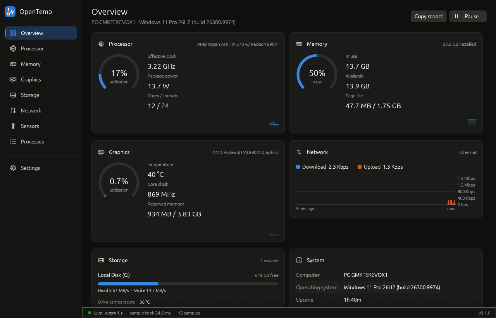
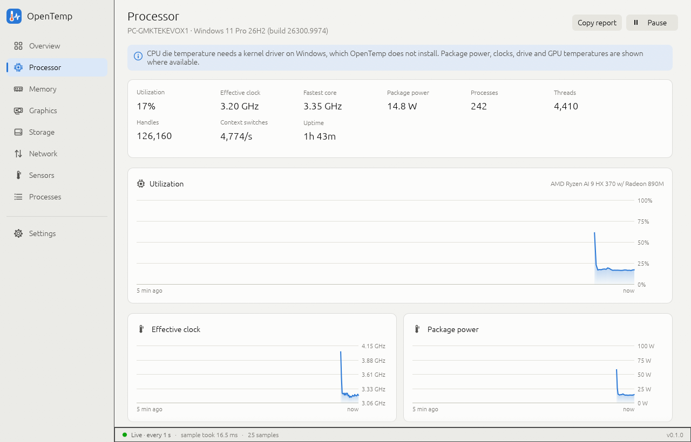

# OpenTemp

A lightweight, native hardware monitor for Windows, Linux and macOS: CPU, GPU,
memory, storage, network, sensors and processes in one window.





- **Single native binary.** Rust with an [egui](https://github.com/emilk/egui)
  interface. No web view, no runtime, no installer. About 6.5 MB on Windows.
- **Light on the machine it measures.** About 0.1% of the CPU at the default
  1-second interval. Sampling runs on its own thread, so the UI never waits on
  hardware.
- **No admin rights, no kernel driver.** On Windows it uses only documented
  user-mode APIs.
- **Private.** No network connections and no telemetry.

## What it shows

| Area | Readings |
|---|---|
| Processor | Total and per-thread utilisation, effective clock per thread, fastest core, package power (RAPL), temperature where the OS exposes it, hybrid core classes (P/E), load average, processes, threads, handles, context switches, uptime, cache sizes and instruction sets |
| Memory | In use, available, cached, committed / commit limit, page file or swap, composition bar, history |
| Graphics | Utilisation per engine (3D, compute, copy, video), dedicated and shared memory, temperature, core and memory clocks, power and fan (when the driver reports them), driver version |
| Storage | Per-volume capacity, read/write throughput and active time; drive health for NVMe (temperature, wear, spare capacity, power-on hours, lifetime reads/writes, unsafe shutdowns, media errors) |
| Network | Per-adapter download/upload rates, totals, link speed, IP and hardware addresses |
| Sensors | Every temperature, power, clock, load, fan, voltage and current sensor found, with min, max, average and a one-minute trend; filterable |
| Processes | The busiest processes by CPU and memory, with threads and disk I/O; sortable and filterable |
| Battery | Charge, charging state, time remaining, power draw and health where reported |

Readings the platform cannot supply are shown as "—" and explained in the app,
never as a misleading zero.

## Platform support

Windows is developed and tested on real hardware (Ryzen AI 9 HX 370 with
Radeon 890M, NVMe SSD). The Linux and macOS collectors compile and pass
`clippy`, but have **not yet been run on real machines**. Treat them as
preview quality until they have been.

| | Windows 10/11 | Linux | macOS |
|---|---|---|---|
| CPU load, per-thread clocks | PDH counters | `/proc/stat`, cpufreq | Mach host stats (no clocks) |
| CPU temperature | ACPI thermal zones only¹ | hwmon (k10temp, coretemp, zenpower…) | SMC (die sensor on Intel, cluster average on Apple silicon)³ |
| CPU package power | RAPL energy meter counters | hwmon where exposed | SMC on Intel³; Apple silicon lists system total power under Sensors |
| GPU load and memory | PDH GPU counters, any WDDM 2.x GPU | amdgpu / i915 sysfs | not yet² |
| GPU temperature and clocks | D3DKMT performance data | amdgpu hwmon, DPM tables | GPU temperatures via SMC³; clocks not yet² |
| NVIDIA details | NVML (loaded at runtime) | NVML (loaded at runtime) | n/a |
| Disk throughput | PDH LogicalDisk | `/proc/diskstats` | not yet² |
| Drive temperatures | storage driver health log, no admin | hwmon (nvme, drivetemp) | SMC³ (Mac models that report it) |
| NVMe health (wear, hours, errors) | storage driver health log, no admin | not yet | not yet² |
| Fans | not available without a driver | hwmon | SMC³ (RPM and maximum) |
| Network | IP Helper (64-bit counters) | `/proc/net/dev`, sysfs | `getifaddrs` |
| Processes | `NtQuerySystemInformation` | `/proc/<pid>` | libproc |
| Battery | `GetSystemPowerStatus` | `power_supply` | not yet² |

¹ Reading the CPU die temperature on Windows needs a kernel driver (as
LibreHardwareMonitor and HWiNFO use). OpenTemp deliberately ships none: such
drivers run with full kernel privileges and some have been used as attack
vectors. Package power, clocks, GPU and drive temperatures are still available.

² Needs further IOKit work (GPU statistics, IOReport, the battery registry).

³ Read from the System Management Controller through IOKit, no root needed.
   Keys are discovered at start-up, so each Mac model shows what it actually
   reports; temperature keys reading outside 5–130 °C are ignored as
   placeholders. Not yet verified on real Macs.

## Build and run

Requires a recent stable Rust toolchain (edition 2024).

```sh
cargo run --release
```

On Linux the GUI needs the usual X11/Wayland development libraries (for
example on Debian/Ubuntu: `libxkbcommon-dev libgl1-mesa-dev libx11-dev
libwayland-dev`).

### Command-line options

```text
opentemp                 Start the app
opentemp --page cpu      Open on a page: overview, cpu, memory, gpu, storage,
                         network, sensors, processes or settings
opentemp --json          Print one snapshot of every reading as JSON and exit
opentemp --version
```

`--json` takes two samples one second apart so rates are filled in. It is
handy for bug reports and scripting.

### Keyboard

| Keys | Action |
|---|---|
| Ctrl+1 … Ctrl+9 | Switch page |
| Ctrl+P | Pause or resume updates |
| Ctrl+F | Filter sensors or processes |
| Ctrl+, | Settings |
| Tab / Enter | Move between and activate controls |

## Features worth knowing

- **Settings** persist between runs: theme (system, light, dark), interface
  size (75–200%), °C/°F, update interval (250 ms–5 s), history length (1 min–1
  h), temperature thresholds, per-core clock display.
- **CSV logging**: Settings → Logging appends one row per sample (CPU, memory,
  network, each GPU and every sensor present when logging starts).
- **Copy report**: copies every current reading plus system info as JSON.
- **Status levels** (Elevated, High, Critical) always come with a text label,
  never colour alone. Sensors that declare their own limits use them; the
  rest use the thresholds in Settings.

## Architecture

```text
src/
  main.rs            entry point, CLI flags
  model.rs           plain data types shared by collectors and UI
  sampler.rs         background thread: sample → history → repaint; CSV logger
  history.rs         time-series ring buffers, min/max/avg, derived sensors
  format.rs          units and number formatting
  settings.rs        persisted preferences
  collect/
    mod.rs           Collector trait, rate and per-process CPU helpers, CPUID
    windows/         PDH, DXGI + D3DKMT, IP Helper, storage IOCTLs, NT process list
    linux.rs         /proc and /sys
    linux_parse.rs   pure parsers for /proc formats (tested on every platform)
    macos.rs         Mach, sysctl, getifaddrs, getmntinfo, libproc, SMC sensors
    smc.rs           SMC client (IOKit) and value decoding / key labelling
    nvml.rs          NVIDIA NVML, loaded dynamically
    nvme.rs          NVMe SMART/health log decoder
  ui/
    mod.rs           app shell: navigation, top bar, status bar, shortcuts
    pages.rs         one function per page
    chart.rs         time-series chart and sparklines (custom painter)
    widgets.rs       cards, stat tiles, meters, tables, vector icons
    theme.rs         light and dark palettes, status levels
    devshot.rs       dev-only screenshot hook (feature `dev-screenshot`)
```

Each platform implements one trait:

```rust
pub trait Collector: Send {
    fn static_info(&self) -> StaticInfo;
    fn sample(&mut self) -> Snapshot;
}
```

Every reading a platform might not have is an `Option`, so "unknown" is never
shown as zero. Rates (bytes/s, CPU %) come from counter deltas through a
shared `RateTracker`, which ignores counter resets and wraps instead of
reporting spikes.

The code is original. Projects such as LibreHardwareMonitor, btop,
`sysinfo` and Task Manager's documented counters informed *which* OS
interfaces exist; no code was copied. Runtime dependencies are eframe/egui
(UI), serde (settings and JSON), libloading (NVML), and the `windows` / `libc`
binding crates.

## Development

```sh
cargo test                      # unit tests (parsers, formatting, rates, tables)
cargo clippy --all-targets
cargo check --target x86_64-unknown-linux-gnu   # after `rustup target add …`
cargo check --target aarch64-apple-darwin
```

To capture the UI headlessly (used to review layout changes):

```sh
OPENTEMP_SCREENSHOT=out.png OPENTEMP_SCREENSHOT_SIZE=1280x820 \
OPENTEMP_SCREENSHOT_AFTER=10 cargo run --features dev-screenshot -- --page cpu
```

Optional `OPENTEMP_SCREENSHOT_THEME=light|dark`.

## Roadmap

- macOS: battery, GPU load and clocks, disk throughput via IOKit.
- Run and tune the Linux and macOS backends on real hardware.
- Optional tray icon and alert notifications when a threshold is crossed.
- Per-process GPU usage on Windows (the PDH data is already collected).
- CI on all three platforms and signed release builds.
